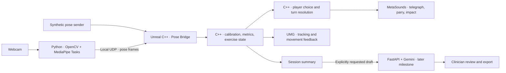

# AthleteMind · Unreal Engine build plan

AthleteMind is a single-player, turn-based rehabilitation game set in a cyberpunk arena. The player reads an enemy's intent and chooses a response. One clinician-configured exercise repetition powers that response. Combat waits for the player. The physical work ends when the prescribed set ends or the player chooses to stop.

## Play The Last Beacon

Open `Content/AthleteMind/Lvl_RehabDuel` and press **Play**. Choose **Practice battle** to try a whole encounter with a controller, keyboard or mouse. Practice lets you preview the movement pictures and animations without turning on a camera or recording exercise reps.

### Play from your exercise position

1. With a gamepad, use the **D-pad** to move the highlighted outline and **A (Xbox) / Cross (PlayStation)** to select. **Menu / Options** pauses or resumes. Mouse clicks and the printed keyboard shortcuts also work.
2. For tracking, choose **Play with webcam**, then **Start webcam**. An already running sender connects automatically. On a new Windows checkout, run `python .\PoseBridge\start_webcam.py` from the project folder once to install the sender and model.
3. Face the direction shown in the movement picture and put the camera on the measured side shown on screen. Include your shoulder, elbow, wrist, hip, knee and ankle. Use **X / Switch** to choose the side you intend to exercise. Hold your starting stance for half a second for the demo to learn it. Once the starting leg is visible, choose **Hands-free battle** or **Use buttons**. Both modes score the exercise automatically. The local preview from `start_webcam.py` draws elbows and wrists and lists missing arm landmarks for each side.
4. In hands-free menus, lower the indicated hand beside your hip. To browse, reach that hand forward at shoulder height and hold until the bar fills. To select the outlined option, bring the hand near the same shoulder and hold. Lower your hand between commands. When Relay strike is highlighted in a hands-free battle, you can also start standing, squat and return to launch it directly. That same squat counts as the attack. You can enter hands-free mode from the setup screen with the same select gesture.
5. Once a move opens, follow its picture. A squat or dodge reads only the measured hip, knee and ankle. For a hands-free pause, return to the starting stance, reach forward with your **other** arm for half a second, then hold that hand near its shoulder for about a second and a quarter. **Menu / Options** or **P** also pauses. From pause you can resume, skip the move or finish.

Turn **Camera motion** off at the opening screen or in Pause for a fixed camera through impacts. The movement card stays fixed in either mode.

### What the four techniques do

| Technique | Movement | Combat result |
| --- | --- | --- |
| Relay strike (`1`) | Squat, hold, return | Gains 1 charge. Breaks 2 armor while the core is guarded or 1 when exposed. |
| Charged attack (`2`) | Squat, hold, return | Spends 1 charge. Breaks 2 armor while guarded or 3 when exposed. |
| Pulse ward (`3`) | Bend the measured elbow, hold, lower | Breaks 1 armor. Reflects the next pulse so the next round starts without a dodge. |
| Signal flare (`4`) | Lift the measured arm forward, hold, lower | Breaks 1 armor and banks 2 charge. |

On the Stone Golem's turn, hold your starting stance until the bar fills. The Keeper performs the dodge on screen. The movement card shows the current pose and a progress bar. When the signal is lost it shows a framing cue. A confidence loss breaks the hold timer. A gap above 750 ms clears the attempt. After a gap of 350–750 ms the game also restarts if the measured joint moved more than 12 degrees. **K** skips the selected turn, **F** finishes the encounter, and **D** records a stop for discomfort. All four techniques share the same three-round default budget. Dodges have a separate count.

### Configuration and verification

`Config/DefaultGame.ini` contains developer test ranges. `Profile` sets the measured side, knee range and set budget. `CurlProfile` sets elbow flexion and `LiftProfile` sets upper-arm elevation relative to the torso. Set `bEnableArmMoves=False` for a leg-only encounter. The arm lift measures elevation relative to the torso and checks that the arm travels forward using the shoulder line or the hip line. Keep both shoulders or both hips visible. A curl needs the measured hip in view so the game can check that the upper arm stays alongside the torso. The illustrated arm target uses the configured minimum angle. The dodge recognizer measures knee angle stability. The digital-rig comparison covers knee tracking, and the arm techniques and gesture thresholds still need human reference and usability testing. [Knee comparison](PoseBridge/validation/RESULTS.md)

After building the editor target, run both commands from the project folder.

```powershell
python .\PoseBridge\test_duel_runtime.py
python .\PoseBridge\test_hands_free_runtime.py
```

The squat test sends only right-leg landmarks. It checks that returning to a learned 26° starting stance credits a rep, a return hidden by a tracking gap earns zero, and three credited attacks produce two separately counted dodges. The hands-free test uses Unreal gamepad events and synthetic pose packets. It checks an elbow curl with a one-frame angle spike, an arm lift with the wrist hidden, and a Relay strike with the measured arm hidden.

Webcam session summaries are saved in `Saved/RehabSessions`. Schema version 3 records the exercise and peak angle per rep, wards cast, and whether hands-free menus were active. Elbow and knee flexion use `estimated_peak_flexion_deg`. Arm elevation uses `estimated_peak_arm_elevation_deg`.

### Stone Golem and session reports

A completed exercise starts the combat animation. For a dodge, hold the starting stance and let the Keeper move on screen. The Keeper uses Magic Strike or Fireball Spell to attack and Magic Defend to evade. The Stone Golem uses Ground Mana Shot to attack and Cast Stop Spell during its evasive step. Both golem clips were baked onto its own skeleton from Combat Magic Anims.

At the end of a webcam encounter, Unreal saves the measured results and starts `PoseBridge/session_report.py`. Configure `GEMINI_API_KEY` as a Windows user environment variable before launching the editor. The worker also accepts `GOOGLE_API_KEY`. The default model is `gemini-3.8-flash`. Set `GEMINI_MODEL` to choose another available generateContent model.

The worker sends the measured side, planned and completed counts, skips, interruptions, dodges, finish reason, and peak angle estimates grouped by exercise. The results screen shows the Gemini recap. The full `<session>.report.txt` beside the original JSON includes the exact local figures. A failed request leaves the summary available and offers **Retry report**. Practice stays local. Pass `-NoSessionReport` to disable report generation for a run.

To generate a report later, run `python PoseBridge/session_report.py "Saved/RehabSessions/<session>.json"` with the configured key. [Gemini API documentation](https://ai.google.dev/api/generate-content)

<details>
<summary>Dusk Station environment artwork</summary>

The distant city uses the built-in image generator. The final texture and unlit material live in `Content/AthleteMind/Environment`. The terrace, relay lights, boss, character and effects render in 3D.

**Generation prompt**

Create an original wide cinematic matte painting for the distant environment of an Unreal RPG arena, Dusk Station. View from a high stone terrace across a vast, silent, partly flooded retrofuturist art-deco city at blue hour. Elegant tiered towers, tarnished brass spires, delicate hanging viaducts, etched architectural details, vapor rising through the lower city and layers of blue slate mist. A slim warm crescent in the upper left above a break in the cloud cover. Cool dusk light, restrained gold windows. Handcrafted premium narrative game environment, atmospheric and spatially coherent, restrained contrast through the middle so real-time characters in front read clearly. Landscape 16:9 full bleed. Distant architecture and sky only. No characters, floor or nearby terrace, text, logo, HUD or borders.

</details>

## Turn and exercise design

**Demo promise.** A player can tell what the Stone Golem intends, choose how to respond, see why a repetition counted or was interrupted, and review the set afterward. The prototype uses a separate duel map and a developer test profile. A clinician supplies the exercise parameters for any prescribed session.

| Moment | Player experience | Implementation |
| --- | --- | --- |
| Set up | See the measured side and a framing cue. Stand in neutral until the game shows Ready. | The exercise manager loads side, target band, hold duration, return threshold, planned rep count and rest settings. Calibration checks signal stability and records baseline. It never sets a deeper target from an observed maximum. |
| Read and choose | Choose **Relay strike** to build a charge or spend one on **Charged attack**. Take as long as needed to choose. | A C++ encounter controller owns turn state and game resources. Both attacks use the same squat profile. |
| Perform | Lower into the configured band, see a target cue, then return to neutral. | A C++ squat component evaluates fresh, confident hip–knee–ankle samples on the configured side. A stable hold arms the response. Return to neutral emits one completed rep with a unique ID. |
| Resolve and defend | The attack lands. After a rest, a steady starting stance triggers the Keeper's dodge. | One completed squat powers one attack. Dodging uses a fresh, confidence-gated hold and its own counter. |
| Rest or finish | Rest, pause, skip the attempt, report discomfort, or end the set. See the reps credited and any interruptions. | A session ID spans sender reconnects. Give each attempt an outcome. Mark an interrupted attempt as unscored and let the player decide whether to resume. End at the prescribed limit regardless of enemy health. |

**Implemented in C++.** Synthetic and webcam senders share the same UDP receiver and squat state machine. The duel HUD shows the current movement cue. Returning to neutral after a qualifying hold credits the rep, resolves the selected response and records the estimated peak angle for review. The encounter controller owns charge and turn state.

**First acceptance run.** From neutral, a target hold followed by a return produces exactly one rep and one turn resolution. Holding at depth, crossing the threshold repeatedly, or replaying the completion event produces zero extra resolutions. Occluding the measured knee halfway through freezes the encounter and records an interruption. Reconnecting while crouched requires a fresh neutral start. Rest and early finish work from every active phase.

### How to tell whether the game helps

**Prototype decision after the rig test.** Give the player unlimited time to choose a relay strike or charged attack. Resolve one choice on one completed movement cycle. Show a simple phase cue and reserve numeric angles for the review screen. If the measured leg drops out, freeze the enemy, preserve the choice and offer resume, skip or finish. Record a skipped or interrupted attempt separately. Keep precision bonuses, extra depth and speed out of the reward calculation. Offer the measured-side camera setup for testing and verify it against reference data before using it with patients. [Measured results and limitations](PoseBridge/validation/RESULTS.md)

- **Measurement.** Agree with a physiotherapist on the intended camera setup, measured side, reference method and acceptable error before testing. Compare the Lite model's estimates with synchronized reference samples at matched times. Record signed error, absolute error and usable-sample coverage. Repeat with camera rotation, changed distance and partial occlusion to identify setups the game should reject. A published squat study used the Heavy model and standardized lateral video from healthy adults. Our Lite webcam setup needs its own evidence. [Single-camera knee-angle validation study](https://rehab.jmir.org/2026/1/e102399/)
- **Rep recognition.** Have a reviewer label completed, partial and interrupted attempts independently. Compare events per attempt and report missed reps, extra counts and unscored attempts. Keep uncertain attempts in the denominator so poor tracking stays visible.
- **Player value.** In a supervised usability pilot, compare the same configured set with a plain rep counter and with the encounter. Alternate their order across participants and keep total exercise volume within the prescribed session. Compare completed versus planned reps, whether players understood the cue, and willingness to use the mode again. Review frustration, discomfort self-reports and reasons for stopping alongside completion. A player who stops early still gets a useful summary.
- **Clinician value.** Give the reviewer a local session summary with the prescription, observed rep count, estimated range, tracking coverage, interruptions and optional self-report. Ask whether they can tell which reps deserve review. Use that feedback to design the dashboard and the later SOAP draft.

## Architecture



| Layer | Owns | First implementation |
| --- | --- | --- |
| Python sidecar | Camera access, RGB conversion, MediaPipe model, capture timestamps, packet encoding | One camera, one detected person, CPU inference, independently runnable synthetic sender |
| Unreal C++ | Network receiver, frame validation, angles, exercise state, deterministic gameplay events | `UPoseBridgeSubsystem` with automatic C++ startup and a native knee-angle overlay |
| Unreal Blueprints | Encounter presentation, animation montage and Niagara hooks, input prompts and HUD | Start in the existing `Lvl_Combat` when building the encounter |
| MetaSounds | Runtime oscillators, envelopes, filters, and noise for audio cues | Telegraph, guard, counter, and set-completion cues after the encounter works |
| Reporting worker | Selected session metrics and Gemini recap | Python calls Gemini after a webcam session. Clinician-reviewed SOAP drafts remain a separate milestone. |

The starting project targets UE 5.7. The default map is `/Game/AthleteMind/Lvl_RehabDuel`, and the combat variant is `/Game/Variant_Combat/Lvl_Combat`. The bridge can run in either. For the encounter, reuse the combat character, health, damage interface, and montage patterns where they fit. Put exercise and parry rules in dedicated classes so the template's keyboard and controller inputs stay available for ordinary combat and developer testing.

## Milestone 0 · Webcam to Unreal

Implemented files

- [`PoseBridge/send_pose.py`](PoseBridge/send_pose.py) publishes the same protocol from the webcam or a synthetic pose. The synthetic mode uses only Python's standard library.
- [`PoseBridgeSubsystem.h`](Source/MediapipeCombat/Pose/PoseBridgeSubsystem.h) defines the C++ API and frame types. [`PoseBridgeSubsystem.cpp`](Source/MediapipeCombat/Pose/PoseBridgeSubsystem.cpp) validates datagrams, tracks freshness, and calculates joint angles.

The UE 5.7 editor target built successfully. A standalone Unreal smoke test received synthetic angles, handled explicit no-pose frames, rejected invalid and repeated frames, expired the feed, and recovered when a new sender connected. The Python packages and Lite bundle are installed. The benchmark process could enumerate the production bundle but lacked permission to read it, so the recorded rig comparison used separate Full model weights.

### Run the synthetic feed

For a quick test, open `MediapipeCombat.uproject` in UE 5.7 and press **Play** with one player. The C++ game instance subsystem starts the listener and the editor displays the knee-angle overlay. Run the sender command below from the project root.

For a standalone development run, use these commands from the project root. Build the editor target after changing C++ or Blueprint-exposed types. Close any open editor instance before rebuilding to release the project DLL.

```powershell
$ue = 'C:\Program Files\Epic Games\UE_5.7'
$project = (Resolve-Path .\MediapipeCombat.uproject).Path
& "$ue\Engine\Build\BatchFiles\Build.bat" MediapipeCombatEditor Win64 Development "-Project=$project" -WaitMutex
& "$ue\Engine\Binaries\Win64\UnrealEditor.exe" $project -game
```

In another terminal run the synthetic sender.

```powershell
python .\PoseBridge\send_pose.py --synthetic
```

The overlay starts at `Waiting`, then switches to `Tracked`. Both knees cycle from about 180° to 90° and back over four seconds at the default rate. Press Ctrl+C in the sender terminal. The overlay should show `Stale` and clear the angles after about 500 ms. Restart the sender and confirm it recovers. In the editor target, the overlay appears automatically. Use `-PoseBridge` for a quiet listener or `-NoPoseBridge` to disable automatic startup. For a packaged development build use `-PoseBridgeDebug` to show the overlay. `-PoseBridgePort=8766` changes the receiver port when paired with `--port 8766` on the sender. Use one Unreal instance and one sender per port.

For an automated check after building, run the following from the project root. It launches a headless game on a temporary port, sends synthetic and fixed test poses, and closes its game process. The test compares fixed poses to 180 and 90 degrees because the first sample consumed from a moving feed can vary with game timing.

```powershell
python .\PoseBridge\test_bridge_runtime.py
```

### Run the webcam feed

Stop the synthetic sender, open the Unreal project and press **Play** with one player. From the project root in Windows PowerShell, run:

```powershell
python .\PoseBridge\start_webcam.py
```

The launcher prepares `PoseBridge/.venv`, installs the pinned packages there, and downloads Google's Pose Landmarker Lite bundle into `PoseBridge/models` on first use. It starts camera 0 and sends landmarks to the existing Unreal receiver on port 8765. [MediaPipe Pose Landmarker documentation and model bundles](https://developers.google.com/edge/mediapipe/solutions/vision/pose_landmarker?tab=Python)

The preview draws visible shoulder, hip, knee and ankle points on the local camera image. Face the camera and step back until you see both legs. The Unreal overlay should switch from `Waiting` to `Tracked`. Check that the knee readings change as you move. Press **Q** in the preview or **Ctrl+C** in the terminal to release the camera. Use `--no-preview` for a game-only display or `--camera 1` to select another device. Only the landmark packet is sent to Unreal. The preview stays local.

Use a well-lit area with your hips, knees, and ankles visible. Confirm that the game reports tracking and the angle changes as a visible knee flexes. Step out of frame and check for `NoPose`. Return to the frame and confirm tracking resumes. If OpenCV opens the wrong webcam, try `--camera 1`. A missing connection appears as `Waiting` or `Stale`. `Tracked` with `--` for a knee means the required landmarks failed the debug confidence check or the angle is undefined.

### Native C++ integration

The game instance owns one `UPoseBridgeSubsystem` across level travel. Its `Initialize` opens the loopback socket for local play. Its game-thread ticker consumes incoming frames, checks freshness even when the sender goes silent, and updates both knee readings. `Deinitialize` unregisters the ticker and closes the socket when play ends. The default map and combat map both use this path automatically.

C++ gameplay code with a game instance can read the same measurement used by the overlay. For example, inside a player controller during play, include `Engine/GameInstance.h` and `Pose/PoseBridgeSubsystem.h` to read the current left knee angle.

```cpp
if (const auto* Pose = GetGameInstance()->GetSubsystem<UPoseBridgeSubsystem>())
{
    float AngleDegrees = 0.0f;
    if (Pose->TryGetLatestJointAngle(23, 25, 27, 0.5f, AngleDegrees))
    {
        // AngleDegrees is valid for this frame. The right knee uses 24, 26, 28.
    }
}
```

For per-frame notifications, a UObject can subscribe its UFUNCTION with `OnPoseFrame.AddDynamic` and remove it at teardown. For tracking interruptions, read `GetTrackingState()` on tick. A silent sender generates no frame event.

### Troubleshooting the first test

| What you see | What to check |
| --- | --- |
| Receiver startup failed | Filter Unreal's Output Log for `LogPoseBridge`. End any other Play session or standalone game using port 8765, then press Play again. |
| `Waiting` while the sender is running | Check that both processes run on the same PC and use the same port. The sender prints its destination. |
| `NoPose` or `Tracked` with a missing angle | For webcam input, bring the hips, knees, and ankles into view. Each knee needs three usable points. Run the synthetic feed to check the receiver independently. |
| `Stale` | Unreal has gone 500 ms without accepting another packet. Check the sender terminal for a camera read error or stopped process. |
| `model file not found` or a missing Python module | Use the webcam setup commands above and run the sender with the virtual environment's Python. The synthetic check can run immediately. |

### Pose protocol v1

Each datagram is one UTF-8 JSON object sent to `127.0.0.1:8765` by default. The byte limit is 8192. The example below is a complete no-pose frame.

```json
{"version":1,"session":"f882ca9a-c304-4798-b503-441d8e829714","seq":0,"capture_ms":70231,"tracked":false,"world":[]}
```

| Field | Meaning |
| --- | --- |
| `version` | Integer `1`. Incompatible payload changes require a new version. |
| `session` | Nonzero hyphenated UUID generated on sender startup. |
| `seq` | Nonnegative integer increasing within the session. Gaps are allowed. |
| `capture_ms` | Nonnegative monotonic milliseconds at camera frame delivery to Python. Increases within a session. |
| `tracked` | `true` if the sender has a complete pose. The per-landmark scores still determine metric validity. |
| `world` | Exactly 33 MediaPipe-ordered rows when tracked. Each row is `[x, y, z, visibility, presence]`. Untracked frames use `[]`. |

Positions are in MediaPipe world axes, in meters and relative to the hip midpoint. The receiver allows finite coordinates within ±10 m and scores from 0 to 1. Joint angles are unchanged by a rigid axis remap or uniform unit conversion, so the bridge keeps source coordinates. An avatar visualizer will need an explicit axis conversion, centimeters, and a placement transform. [MediaPipe landmark output and indices](https://developers.google.com/edge/mediapipe/solutions/vision/pose_landmarker?tab=Python)

The game polls a nonblocking socket and reads up to 32 datagrams per engine tick. It publishes the newest accepted frame, skips duplicates and out-of-order frames, and waits until the current session is stale before accepting a different sender session. At 500 ms without a valid packet, the getters stop returning poses. `capture_ms` belongs to the sender clock. Use it for time between frames and use Unreal's clock for local freshness and encounter animation. UDP keeps the prototype local and avoids retransmitting obsolete poses. Any remote deployment needs a separate transport design.

## Milestone 1 · Tracking and one exercise

1. Add a `PoseDebug` actor or widget that shows left and right knee readings, per-joint confidence, and a pose timestamp or sequence. Add a point or skeleton view only after verifying side labels and the display transform with known motions.
2. Add a squat exercise component in C++ and tune its parameters in an exercise data asset. Use a calibration step for neutral stance and target range. Keep exercise configuration per profile while the rules remain shared.
3. Calculate each included knee angle with `acos(clamp(dot(normalize(hip - knee), normalize(ankle - knee)), -1, 1))` and convert to degrees. If the HUD uses a flexion convention of zero near straight, display `180° - included angle` and label it explicitly. Record which convention the session summary uses.
4. Advance `Ready → Descending → Target Reached → Returning → Ready` using confidence gating, distinct entry and exit thresholds, and a stable hold at the target. Emit one completed-rep event on return. Clear unfinished reps after tracking loss and require reacquisition from neutral. Use elapsed time for smoothing and dwell, with reset on large sequence or timestamp gaps.
5. Name the first feedback messages after observable signals such as lost tracking, target reached, or return to neutral. Add knee alignment, pelvic tilt, or trunk extension cues only once each metric has a documented coordinate frame, viewing conditions, and validation data. MediaPipe returns estimated landmarks. Three-point limb angles alone cannot establish joint-plane motion or distinguish lumbar extension from whole-trunk tilt. [MediaPipe Pose Landmarker output and model description](https://developers.google.com/edge/mediapipe/solutions/vision/pose_landmarker?tab=Python)

**Acceptance.** A scripted pose sequence that goes down, holds, and returns counts exactly once. Holding still, hovering at the threshold, dropping tracking mid-rep, and high-confidence samples with coincident points never count as a valid completed rep. Log pose availability and end-to-end feedback latency during camera trials. Use a prototype target of p95 below 150 ms on the development machine, measured by filming both the movement and the resulting display or by instrumenting a common clock.

## Milestone 2 · First turn-based encounter

The playable duel map runs `Show Intent → Choose Response → Await Rep → Resolve → Rest or Finish`. C++ owns the on-screen controls, turn state and opponent animation. Integration tests feed the same UDP receiver as the webcam. Each local summary identifies the developer exercise profile. Future presentation work can add UMG controls, Niagara effects and MetaSounds around the verified turn sequence.

**Acceptance.** Relay strike and charged attack have distinct tactical outcomes at the same configured physical workload. Tracking loss, long rests and repeated inputs never advance the enemy turn. A session can finish early and another can start with fresh encounter state.

## Milestone 3 · Session summary and SOAP draft

1. Save a versioned summary locally with a session ID, exercise configuration version, rep and parry counts, angle convention and ranges, tracking coverage, interruptions, planned and completed reps, and optional patient-entered discomfort. Raw camera frames stay in memory during capture. Landmark recording for replay is a separate, opt-in development feature.
2. Generate an on-demand SOAP draft through a FastAPI service. Store the provider credential outside Unreal and the sender. Send only the selected summary fields and authorized user-entered context. Validate the Gemini response against a schema and render it as an editable draft. [Gemini structured output documentation](https://aistudio.google.com/docs/structured-output)
3. Put user- or clinician-entered observations in **Subjective**. Use verified telemetry for **Objective**. Keep **Assessment** and **Plan** editable for clinician review. Mark missing inputs explicitly and require review before sharing or exporting a clinical note. A provider failure leaves the local summary available.

**Acceptance.** A synthetic session with known values renders those values correctly. Missing self-report stays missing, a malformed response never overwrites the summary, and no report call occurs during active gameplay.

## Milestone 4 · Validation and Windows packaging

- Replay deterministic poses for angle math, rep transitions, and turn resolution. Check camera trials across viewing angles, lighting, occlusion, and restart scenarios. Report tracking coverage, false rep counts, and latency separately from game scores.
- Before presenting anything as a clinical assessment, define the intended use and measure agreement against an appropriate reference method with a clinician. Record uncertainty and review the wording for each proposed movement cue.
- Package Unreal and the capture sidecar as separate artifacts first. Verify on a clean Windows machine, including camera permissions, missing model, occupied port, crash and restart recovery, and a camera-free demo. Consider a launcher that manages both processes once the split workflow is stable.

The six product systems are body tracking, biomechanics, Unreal gameplay, exercise management, AI-assisted reporting and a clinician dashboard. The first playable milestone connects the first four to a local summary. Build the clinician history and progress view from reviewed summaries, then add optional AI drafting once the metrics and their limitations are understood.
